### Building web applications, security tools, and automation scripts

 

<!-- ============ BANNER / IMAGES (optional) ============
Upload your image to the repo, then uncomment and edit:

  

-->

## 🔗 Connect with me

  <!-- Replace YOUR-... with your real links, delete any you don't want -->
  
  
  

## 🛠️ Languages and Tools

**Languages**

  
  
  
  
  
  
  
  
  
  
  
  
  

**Frontend and Testing**

  
  
  
  
  
  
  
  
  
  
  

**Backend and Databases**

  
  
  
  
  
  
  
  
  
  
  
  
  
  
  

**DevOps and Infrastructure**

  
  
  
  
  
  
  
  
  
  
  

**Desktop, Mobile and Hardware**

  
  
  
  
  
  
  
  
  
  
  

## 📊 GitHub Stats

  
  

 

<picture>
  <source media="(prefers-color-scheme: dark)" srcset="https://raw.githubusercontent.com/CheeseBallz/CheeseBallz/pacman-output/pacman-contribution-graph-dark.svg?game=pacman">
  <source media="(prefers-color-scheme: light)" srcset="https://raw.githubusercontent.com/CheeseBallz/CheeseBallz/pacman-output/pacman-contribution-graph.svg?game=pacman">
  
</picture>

